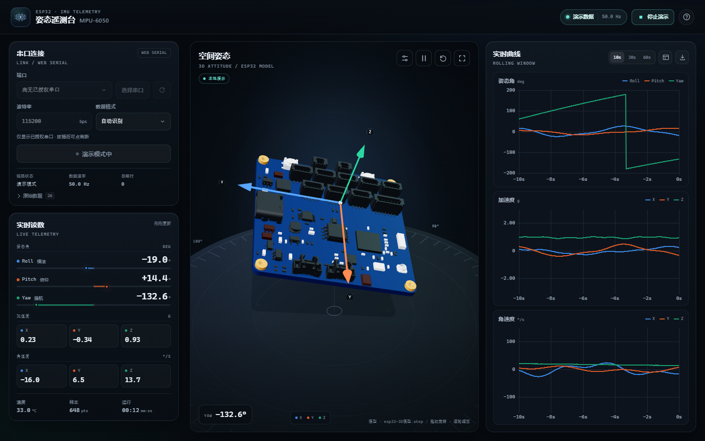

# MPU-6050 姿态遥测台

一个完全在本机运行的实时姿态仪表盘：浏览器通过 Web Serial 读取 ESP32 串口数据，展示 Pitch / Roll / Yaw、加速度、角速度、温度和三组滚动曲线，并用 `esp32-3D模型.step` 转换出的模型实时展示三维姿态。



> **当前状态（2026-11-13）**：页面、演示模式、模拟串口连接/断开、协议解析、串口刷新、数据表/CSV 导出、3D 模型加载与失败回退已在本机 Chrome 验证。真实 MPU-6050 + ESP32 固件请按第 9 节做一次实机验收。

**运行时不需要构建、不需要 Node.js、不需要联网。** 前端依赖全部在 `vendor/` 中，启动脚本是 Windows 的 PowerShell 本地静态服务器。

> **新 Agent 推荐阅读顺序**：0（交接摘要）→ 2（架构）→ 3（模块）→ 5（数据契约）→ 6（3D）→ 8（修改指南）→ 9（验证清单）。详细协议以 [docs/serial-output-spec.md](docs/serial-output-spec.md) 为准。

---

## 0. Agent 交接摘要（新接手的 Agent 先读这一节）

### 0.1 项目定位

- 纯静态前端：`index.html` + `src/*.js` ES modules + `src/styles.css`
- 本地入口：[start.bat](start.bat) → [server.ps1](server.ps1) → Chrome / Edge
- 串口：Web Serial（Chromium 桌面浏览器 + `localhost` 安全上下文）
- 推荐串口参数：**115200 bps，8N1，无流控，50 Hz JSON 行**（网页默认 115200；频率可调）
- 三维：three.js 本地渲染；`assets/esp32.glb` 是 Meshopt 压缩模型
- 图表：uPlot，本地 vendored
- **没有根 `package.json`、没有打包步骤**；改完前端文件刷新页面即可

### 0.2 关键路径

| 用途 | 文件 |
|---|---|
| 页面结构、所有 DOM id、帮助/数据表弹窗 | [index.html](index.html) |
| 全局状态、串口 UI、演示数据、图表刷新、偏好设置、模型加载 | [src/main.js](src/main.js) |
| Web Serial 读循环、打开/关闭、物理断连事件 | [src/serial.js](src/serial.js) |
| JSON / CSV / 键值对解析、字段别名 | [src/protocol.js](src/protocol.js) |
| 环形缓冲、图表降采样、数据表、CSV | [src/buffer.js](src/buffer.js) |
| uPlot 曲线、同步十字线、tooltip | [src/charts.js](src/charts.js) |
| three.js 场景、占位模型、高清 GLB、姿态四元数 | [src/model-view.js](src/model-view.js) |
| 数据系列颜色（已验证暗色对比/色盲区分） | [src/palette.js](src/palette.js) |
| 本地服务器、缓存头、端口回退 | [server.ps1](server.ps1) |
| 下位机正式串口契约 | [docs/serial-output-spec.md](docs/serial-output-spec.md) |
| 合法 JSON 帧样例 | [docs/serial-sample.jsonl](docs/serial-sample.jsonl) |
| STEP → GLB、Meshopt 压缩 | [tools/step_to_glb.js](tools/step_to_glb.js), [tools/optimize_glb.mjs](tools/optimize_glb.mjs) |
| ESP32 示例固件 | [firmware/esp32_mpu6050_json/esp32_mpu6050_json.ino](firmware/esp32_mpu6050_json/esp32_mpu6050_json.ino) |

### 0.3 当前约定，不要随意改

1. **数据单位和符号**：角度 deg、加速度 g、角速度 °/s、温度 °C；坐标 X 朝前、Y 朝左、Z 朝上；Roll 正=右侧下沉，Pitch 正=抬头，Yaw 正=俯视逆时针。完整定义见第 5 节。
2. **串口格式**：一行一个 JSON 对象，`\n` 结尾，115200 8N1。正式下位机对接以 [docs/serial-output-spec.md](docs/serial-output-spec.md) 为准。
3. **3D 加载策略**：页面初始化先显示程序生成的轻量预览板，高清 GLB 在后台加载并自动替换。**不要再加入阻塞式加载遮罩**；高清模型加载失败时必须保留预览，不能让 3D 视图变空。
4. **Meshopt**：当前 `assets/esp32.glb` 使用 Meshopt 压缩，[src/model-view.js](src/model-view.js) 中的 `loader.setMeshoptDecoder(MeshoptDecoder)` 不可删除；替换为未压缩 GLB 时才可考虑移除。
5. **模型缓存版本**：模型 URL 带 `MODEL_VERSION`（[src/main.js](src/main.js)），服务器对 `assets/`、`vendor/` 使用 7 天缓存。替换模型后必须递增 `MODEL_VERSION`，否则浏览器继续用旧文件。
6. **静态资源本地化**：不要把 three.js / uPlot / 字体改成 CDN 依赖；当前页面离线可用。
7. **串口数据一律用 `textContent` 写入 DOM**，不要用 `innerHTML` 拼接串口内容。
8. **端口授权**：不要假设可以枚举全部 COM 口。新设备必须由用户手势触发 `navigator.serial.requestPort()`；刷新只能更新已授权端口。

### 0.4 当前 UI 的运行状态检查

在 DevTools 中查看：

```js
document.querySelector('#viewer-panel').dataset.model
// placeholder → 预览板已显示，高清模型加载中
// ready       → 高清 GLB 已加载并替换预览
// fallback    → 高清 GLB 加载失败，保留简化预览
// unavailable → WebGL 初始化失败
```

同时查看：

- `#model-source`：`模型预览` → `模型 · esp32-3D模型.step` / `模型 · 简化预览`
- 全局状态 pill `#global-state-text`：未连接 / 演示数据 / 串口已连接 / 等待数据
- 页面 Console 应该没有红色错误

---

## 1. 快速开始

1. 双击根目录的 **`start.bat`**。
2. 它会启动只监听 `localhost` 的静态服务器，并打开 Chrome / Edge。
3. 点击「选择串口」，在浏览器弹出的设备窗口中选择 ESP32。
4. 确认波特率与下位机一致（默认 **115200**），点击「连接串口」。

> `start.bat` 的 PowerShell 窗口要保持打开。网页必须通过 `http://localhost:<port>/` 访问；直接双击 `index.html` 会缺少 ES module 加载环境，也不能使用 Web Serial。

### 没有硬件

点击右上角「演示数据」即可看到三维姿态、曲线和实时读数联动。演示模式不经过串口解析器，它只验证 UI/3D/图表链路。

### 拔插设备 / 新增串口

- 端口下拉框右侧有 **刷新按钮**，用于重新读取已授权串口。
- 浏览器只会列出已授权的串口。**从未授权过的新设备**必须再点一次「选择串口」，在浏览器设备窗口中授权。
- 刷新按钮在连接中、已连接或演示中禁用；断开后可用。
- 串口被独占，连接网页前请关闭 Arduino 串口监视器、PlatformIO Monitor 等。

### 页面更新后

- 修改 `index.html` / `src/*`：普通刷新即可（应用代码不缓存）。
- 修改 `server.ps1`：关闭原命令行窗口，重新双击 `start.bat`。
- 修改 `vendor/` 或 `assets/`：服务端有 7 天缓存；开发调试时用 `Ctrl+F5` 强制刷新。替换模型时还需要递增 `MODEL_VERSION`。
- 若页面样式或行为仍是旧的，先关闭旧页面重新打开，并强制刷新一次。

---

## 2. 架构与数据流

```text
ESP32 UART/USB
   │  115200 8N1，一行一条数据
   ▼
SerialConnection (src/serial.js)
   │  按 \n / \r\n 拆行；容忍启动日志；行缓冲上限 64 KB
   ▼
parseLine (src/protocol.js)
   │  auto / JSON / CSV9 / CSV6 / key-value
   │  校验有限数字、字段别名、缺失字段合并
   ▼
TelemetryBuffer (src/buffer.js)
   │  环形缓冲 60,000 点；主机时间戳；CSV 导出
   ├──────────────► ChartGroup (src/charts.js)
   │                  uPlot；窗口 10/30/60 s；最多 5,000 点/图
   ├──────────────► DOM 实时读数 / 数据表 / 原始串口日志
   └──────────────► AttitudeView (src/model-view.js)
                      预览板 → 后台高清 GLB；四元数平滑旋转

Demo timer (src/main.js)
   └──────────────► handleSample() 直接写入同一份状态和缓冲
```

关键点：

- **时间戳由上位机生成**（`Date.now()/1000`），下位机帧里不需要时间字段。
- 缺少字段的帧会与上一次已知值合并，便于交替发送姿态/IMU 字段；常规固件仍应每帧发完整字段。
- 只有加速度没有角度时，CSV6 / acc-only 数据会推导 Roll/Pitch（Yaw 为空）。
- UI 每 100 ms 更新；3D 渲染走 `requestAnimationFrame`；曲线更新 10 Hz。
- 演示模式固定约 50 Hz，不经过串口解析器。

---

## 3. 文件与模块职责

| 路径 | 职责 |
|---|---|
| `index.html` | 页面结构、连接面板、遥测读数、3D viewer、曲线、原生 dialog、import map |
| `src/main.js` | 应用状态机、串口 UI、演示模式、状态栏、串口列表刷新、数据表、CSV、偏好、模型版本 |
| `src/serial.js` | Web Serial 封装；打开 `port.open({baudRate,...})`；读取、拆行、断连、错误信息 |
| `src/protocol.js` | 串口协议解析；`FIELD_ALIASES`；JSON/CSV/KV；数值清洗 |
| `src/buffer.js` | 60,000 点环形缓冲；窗口数据；按需降采样；最近 200 条数据表；CSV 全量导出 |
| `src/charts.js` | uPlot 三张图；固定六列时间网格；同步十字线；tooltip；对称 Y 轴 |
| `src/model-view.js` | three.js 场景、灯光、阴影、罗盘、坐标轴、占位模型、GLB 加载/校验/替换、平滑姿态 |
| `src/palette.js` | 曲线数据色：X/Roll 蓝、Y/Pitch 橙、Z/Yaw 绿 |
| `src/styles.css` | 全部界面样式和响应式布局；不依赖外部字体/CDN |
| `server.ps1` | 监听 localhost；MIME；路径穿越保护；应用代码 no-store；assets/vendor 7 天缓存 |
| `start.bat` | 启动 PowerShell 服务器并打开浏览器 |
| `assets/esp32.glb` | 运行时三维模型，Meshopt 压缩，约 1.5 MB / 269k 三角形 |
| `esp32-3D模型.step` | 原始 CAD 模型（网页不直接加载） |
| `docs/preview.png` | README 预览图 |
| `docs/serial-output-spec.md` | 下位机串口输出契约（发给固件 Agent） |
| `docs/serial-sample.jsonl` | 四组合法 JSON 帧，可用于模拟串口 |
| `tools/step_to_glb.js` | STEP → 普通 GLB（Node + occt-import-js） |
| `tools/optimize_glb.mjs` | 普通 GLB → Meshopt GLB |
| `tools/package.json` | 模型工具依赖（不是运行时依赖） |
| `firmware/esp32_mpu6050_json/` | ESP32 示例固件，115200 / 50 Hz JSON |
| `vendor/` | three.js r160、OrbitControls、GLTFLoader、MeshoptDecoder、uPlot，全部本地 |

运行时依赖版本（vendor）：

- three.js `0.160.0`
- uPlot `1.6.31`
- meshoptimizer decoder（three 示例中的 `meshopt_decoder.module.js`）
- 模型工具：`occt-import-js 0.0.23`、`@gltf-transform/* 4.5.1`、`meshoptimizer 0.20.0`

---

## 4. Web Serial 行为与限制

- 仅桌面 Chromium：Chrome / Edge。Firefox、Safari、大多数手机浏览器不支持。
- 页面必须在安全上下文：`http://localhost:...` 或 HTTPS。`start.bat` 已处理。
- `navigator.serial.getPorts()` 只返回**本页面已经授权**的端口，因此 UI 的下拉框不是系统完整 COM 列表。
- 点「选择串口」会调用 `requestPort()`，必须由用户点击触发；这是新增串口的唯一途径。
- 刷新按钮 → `refreshPorts()` → 重新调用 `getPorts()`；同时监听 `navigator.serial` 的 `connect` / `disconnect` 事件自动刷新。
- 一次只能打开一个端口。打开失败会显示中文错误提示；常见错误包括端口被占用、设备已拔出、权限被拒绝。
- 串口读取按 `CRLF/LF/CR` 拆行；无法识别的行计入「忽略行」，原始串口内容可在左侧「原始数据」查看。
- 串口选项固定：8 data bits、无校验、1 stop bit、无流控、`bufferSize: 65536`，波特率来自输入框。
- 默认 `115200`。8N1 的理论有效带宽约 11.5 KB/s；50 Hz 完整 JSON 帧约 6.5 KB/s，建议不超过约 60 Hz。需要更高频率时同时提高两端波特率。

---

## 5. 串口数据契约

### 5.1 标准格式（正式对接）

每行一个 JSON 对象，以 `\n` 结束。正式下位机规范见 [docs/serial-output-spec.md](docs/serial-output-spec.md)（当前 v1.1）。

```json
{"roll":1.25,"pitch":-3.40,"yaw":128.60,"ax":0.018,"ay":-0.012,"az":0.997,"gx":0.4,"gy":-0.2,"gz":1.1,"temp":31.5}
```

| 键 | 单位 | 必需 | 说明 |
|---|---|---|---|
| `roll` | ° | 是 | 推荐 -180 ~ +180 |
| `pitch` | ° | 是 | 推荐 -90 ~ +90 |
| `yaw` | ° | 是 | 推荐 -180 ~ +180；也接受累计值 |
| `ax`, `ay`, `az` | g | 是 | 水平静止 `az ≈ +1.0` |
| `gx`, `gy`, `gz` | °/s | 是 | 右手定则角速度 |
| `temp` | °C | 否 | 温度 |

规范要求字段值是有限数字，不要输出 `NaN` / `Infinity` / `null`。解析器对“数字字符串”有一定宽容，但下位机应输出真正的 JSON number，不要依赖这层兼容。

### 5.2 坐标与符号

- 机体坐标：X 朝前、Y 朝左、Z 朝上（右手系）
- Roll 正值 = 右侧下沉；Pitch 正值 = 机头抬起；Yaw 正值 = 俯视逆时针（左转）
- 角速度：`+gx` 向右侧下沉方向，`+gy` 向低头方向，`+gz` 向左转方向
- 固件积分：`Roll += gx·dt`，`Pitch += -gy·dt`，`Yaw += gz·dt`
- 静止水平：`ax=ay=0`、`az≈1g`、角速度≈0
- 加速度姿态角：`roll = atan2(ay, az)`，`pitch = atan2(ax, sqrt(ay²+az²))`

验收姿态：

| 姿态 | 期望 |
|---|---|
| 水平 | roll≈0，pitch≈0，az≈+1.000g |
| 抬头 30° | pitch≈+30，ax≈+0.5g，az≈0.87g |
| 右侧下沉 30° | roll≈+30，ay≈+0.5g，az≈0.87g |
| 左转（俯视逆时针） | yaw 增大，过程中 gz>0 |

如果实际 MPU 安装方向不一致，应在固件中做轴交换/取反；网页「视图校准」只做 Roll/Pitch/Yaw 单轴取反，是最后的视觉兜底，不能替代轴映射。

### 5.3 兼容格式

- **CSV 9/10 列**：`roll,pitch,yaw,ax,ay,az,gx,gy,gz[,temp]`
- **CSV 6 列**：`ax,ay,az,gx,gy,gz`，由加速度推导 Roll/Pitch
- **键值对**：`roll=1.25 pitch=-3.4 ...`（也支持 `:` 分隔）
- **JSON 嵌套**：`{"orientation":{"roll":1,"pitch":2,"yaw":3}}`
- **JSON 数组**：`{"acc":[x,y,z],"gyro":[x,y,z]}`
- **前缀 JSON**：`DATA:{"roll":...}`

字段别名定义在 [src/protocol.js](src/protocol.js) 的 `FIELD_ALIASES`；新增字段别名请同步更新文档并做解析测试。

### 5.4 时间与图表行为

- 时间戳由主机接收时刻生成，不使用下位机时钟。
- Yaw 在 ±180° 回绕处曲线会出现竖直跳变，这是角度表示方式，不是数据错误。
- 曲线使用最新数据窗口，最多 5,000 点/图；CSV 和表格保留完整数据。

---

## 6. 三维模型与加载策略

### 6.1 管线

```text
esp32-3D模型.step
   │ tools/step_to_glb.js  (occt-import-js / OpenCascade)
   ▼
中间 GLB（普通未压缩，~12.7 MB）
   │ tools/optimize_glb.mjs (Meshopt / gltf-transform)
   ▼
assets/esp32.glb（当前发布版，~1.5 MB，314,523 顶点 / 269,090 三角形）
   │ three.js GLTFLoader + MeshoptDecoder
   ▼
3D viewer
```

- 网页**不会加载 STEP**，只加载 `assets/esp32.glb`。
- 模型坐标在转换时烘焙为 Y-up，场景中自动按包围盒居中并缩放到约 2.1 个场景单位。
- 原 STEP 保留在根目录，供以后重建。

### 6.2 加载流程（不要退回阻塞式加载）

1. `AttitudeView` 初始化 WebGL 场景、罗盘、坐标轴，并同步绘制**程序生成的轻量预览板**。
2. 页面立即可以旋转预览、响应串口姿态和演示数据；没有全屏 loading 遮罩。
3. 高清 GLB 在后台加载。
4. 高清模型完成并通过网格数量、包围盒校验后，才替换预览模型；姿态四元数/相机不重置。
5. 若加载失败或模型无效，保留预览并显示提示，串口、曲线、导出继续可用。
6. 高清模型在 `#viewer-panel` 上留下状态：`placeholder` → `ready` / `fallback`；WebGL 失败为 `unavailable`。

**修改模型代码时必须保底**：高清模型替换前不要先清空预览；失败路径必须能重新挂载预览模型。`_attachModel` 目前在验证成功后才清空 `modelPivot`。

### 6.3 姿态映射

三维旋转采用：

```text
q = qYaw(world Y, yaw) * qPitch(world Z, pitch) * qRoll(world X, roll)
```

- 平滑使用四元数 slerp（约 9.5/s 速度因子）。
- 「视图校准」只改变 3D 显示用的 roll/pitch/yaw 正负号，不影响原始串口值、曲线、数据表或 CSV。
- 正 Yaw 俯视逆时针、正 Pitch 抬头、正 Roll 右侧下沉，与第 5 节一致。

### 6.4 缓存与模型版本

- `server.ps1` 对 `assets/`、`vendor/` 返回 `Cache-Control: public, max-age=604800, immutable`。
- 模型 URL 为 `assets/esp32.glb?v=${MODEL_VERSION}`，`MODEL_VERSION` 在 [src/main.js](src/main.js) 中，当前为 `2026-11-13-meshopt1`。
- **替换模型后必须修改 `MODEL_VERSION`**，否则浏览器可能继续使用旧模型缓存；替换后建议强制刷新一次。
- 浏览器缓存和 localStorage 按 origin（含端口）隔离；如果 `start.bat` 因 8080 被占用启动了其他端口，会看不到之前的缓存/偏好。这是正常现象。

### 6.5 重新生成 GLB（可选，运行时不需要）

需要 Node.js 18+：

```bash
cd tools
npm install
npm run build-model
```

这会：

1. 用 OpenCascade（occt-import-js）把 STEP 三角化并烘焙 Y-up、居中；
2. 用 Meshopt 压缩 `assets/esp32.glb`；
3. 最后请修改 `src/main.js` 中的 `MODEL_VERSION` 并刷新页面。

如果只是替换模型、不改代码，模型加载/验证/回退逻辑不需要改。glTF Validator 对 Meshopt 扩展可能报告 `EXT_meshopt_compression` 不支持的信息，这是验证器本身没有解码扩展导致的，不代表浏览器加载失败。

---

## 7. 曲线、数据表与导出

- 三张 uPlot 小图：姿态角、加速度、角速度；同一时间窗口：10s / 30s / 60s。
- 十字线/ tooltip 三图同步；tooltip 显示每个系列同一时刻的值。
- 颜色固定：Roll/X 蓝 `#3987e5`，Pitch/Y 橙 `#d95926`，Yaw/Z 绿 `#199e70`；颜色在暗色面板上已验证。
- 数据表展示最近 200 条，约每秒刷新；CSV 导出全部缓冲点（最多 60,000）。
- 曲线窗口内超过 5,000 点会按步长降采样；表格和 CSV 保持全分辨率。
- Yaw 的 ±180° 回绕跳变是预期行为，README 和帮助弹窗中已说明。

---

## 8. Agent 修改指南

### 8.1 开发运行

- 启动：双击 `start.bat`，或运行 `powershell -NoProfile -ExecutionPolicy Bypass -File server.ps1`。页面需要通过 localhost 访问，不能 file://。
- 没有热重载、没有打包；改完 `index.html` / `src/` / `src/styles.css` 直接刷新。
- 修改 `server.ps1` 后必须重启服务器。
- 浏览器 Console 无红色报错是基线的通过条件。

### 8.2 常见修改

**增加串口字段 / 别名**
- 修改 [src/protocol.js](src/protocol.js) 的 `FIELD_ALIASES`。
- 如果字段属于正式契约，必须同步更新 [docs/serial-output-spec.md](docs/serial-output-spec.md) 和示例固件；否则固件 Agent 会按旧契约实现。

**新增数据格式**
- 在 `src/protocol.js` 的 `parseLine` 增加分支，并在 `index.html` 的格式下拉框和 `src/protocol.js` 的 `PROTOCOL_HINTS` 增加对应选项。
- 必须处理有限数字校验；不要直接 `eval`；解析异常计入「忽略行」，不要让单行错误中断读取。

**修改默认波特率**
- 至少同步四处：`src/main.js` 的 `DEFAULT_PREFS.baud`、`index.html` 输入框默认值、`docs/serial-output-spec.md`、示例固件 `SERIAL_BAUD`。
- 浏览器已保存的偏好不会自动变；如需要，升级 `PREFS_KEY` 或做迁移。

**修改 3D**
- 入口：[src/model-view.js](src/model-view.js)；姿态四元数在 `setAttitude`，加载/回退在 `loadModel` / `_attachModel` / `_attachPlaceholder`。
- 保持「预览先显示、高清后替换」和失败保底；不要加入阻塞式模型遮罩。
- 目前加载使用 MeshoptDecoder；如果更换模型资产，确认扩展与解码器匹配。

**修改图表**
- 图表定义在 [src/charts.js](src/charts.js) 的 `CHART_DEFS`；HTML 中的 legend 也要同步增减。
- 系列颜色在 [src/palette.js](src/palette.js)，X/Roll=蓝、Y/Pitch=橙、Z/Yaw=绿；保持同一轴的颜色一致。
- 图表目前没有第二 Y 轴；不要把不同单位的系列塞进一张图。

**替换 3D 模型**
1. 替换根目录 `esp32-3D模型.step`，或直接放一个符合场景约定的 GLB。
2. `cd tools && npm install && npm run build-model`。
3. 递增 `src/main.js` 的 `MODEL_VERSION`。
4. 刷新页面，确认 `#viewer-panel` 从 `placeholder` 走到 `ready`，页脚模型来源更新。
5. 如果模型无效，页面应保持预览并提示，不应出现空白 3D。替换后建议用 `gltf-validator` 检查一次。

**修改服务器缓存**
- 当前策略：应用代码 HTML/JS/CSS = no-store；`vendor/`、`assets/` = 7 天 immutable。
- 如果修改 vendor 而不改 URL，浏览器可能仍用旧缓存；本地用 Ctrl+F5，发布时考虑版本化 URL。
- 不要为了“开发方便”把应用代码设为长缓存；会导致用户长期运行旧版本。

### 8.3 安全与健壮性

- 串口数据、字段名、原始日志都是**不可信输入**；写 DOM 用 `textContent`。
- 不要给串口数据提供 `innerHTML`/模板字符串注入路径。
- 不要发送命令到下位机；当前应用只读串口。
- 模型文件/第三方库均本地加载；不要引入不必要的 CDN 或遥测。
- 保持 `server.ps1` 的路径穿越检查与仅 localhost 监听。

### 8.4 偏好与状态

- 偏好 localStorage key：`mpu6050-dashboard-prefs-v2`；旧 v1 记录会迁移，旧默认 `1152000` 会迁移到新默认 `115200`。
- 保存内容：波特率、协议、曲线窗口、视图校准；不保存串口权限（浏览器管理）。
- 演示模式/串口会话状态不持久化。
- 模型加载状态通过 `#viewer-panel[data-model]` 暴露，便于 UI 测试。

---

## 9. 验证清单（改动后至少走一遍）

### 9.1 基础启动

- [ ] 双击 `start.bat`，打开页面无 Console 错误
- [ ] 3D viewer 立即出现预览板，没有阻塞式加载界面
- [ ] 预览板随演示数据旋转
- [ ] 高清模型最终替换预览，`#viewer-panel` 为 `ready`，`#model-source` 显示 STEP 来源
- [ ] 断网不影响页面（vendor/模型本地提供）

### 9.2 串口与协议

- [ ] 已授权串口出现在下拉框；未授权新设备必须通过「选择串口」添加
- [ ] 刷新按钮能重新读取列表；连接中/已连接/演示中按钮禁用
- [ ] 串口连接、断开、拔插都能恢复 UI，不卡在「连接中」
- [ ] 用 [docs/serial-sample.jsonl](docs/serial-sample.jsonl) 的帧（真实设备或模拟串口）验证四组静态姿态
- [ ] 解析失败的行进入「忽略行」，原始数据面板显示内容
- [ ] 115200 波特率与固件一致

### 9.3 UI / 交互

- [ ] 演示模式约 50 Hz，姿态、曲线、读数联动
- [ ] 10/30/60s 窗口切换正常；三图十字线同步
- [ ] 数据表打开、刷新、关闭正常；CSV 可下载并含完整表头
- [ ] 视图校准三项分别生效，且不改变曲线/导出
- [ ] 冻结、复位、全屏可用
- [ ] 1440 / 1024 / 390 宽度无横向滚动，图表和串口控件不溢出

### 9.4 3D 失败路径

- [ ] 用 DevTools 阻断 `assets/esp32.glb` 请求：页面应保留简化预览并提示，3D 不为空、无 Console 异常
- [ ] WebGL 不可用时显示 viewer 错误文案，其余遥测功能可用
- [ ] 若修改模型：`data-model=ready`，模型外观与预期一致

### 9.5 测试说明

项目当前**没有自动化测试套件**。上面是人工/浏览器验收清单。若需要自动化，建议用 Playwright/Puppeteer；Web Serial 可通过注入 fake `navigator.serial` 测试连接路径。修改代码后至少做一次本清单中的基础与失败路径检查。

---

## 10. 已知限制与常见问题

### 已知限制

- Web Serial 仅 Chromium 桌面、仅安全上下文；不能在没有用户手势时枚举/选择设备。
- 下拉框只显示已授权端口，刷新不能绕过浏览器权限；首次使用新设备必须点「选择串口」。
- 浏览器缓存和 localStorage 按 origin/端口隔离；`start.bat` 从 8080 开始尝试，端口变化会丢缓存/偏好。
- 单串口独占；连接前需关闭串口监视器等其他程序。
- 没有磁力计，Yaw 会漂移；Yaw 在 ±180° 回绕处曲线会跳变。
- 示例固件需要在具体开发板上修改 I2C 引脚并做实机验证；网页侧没有真实的 MPU-6050 自动化测试台。
- 当前模型约 1.5 MB；页面不阻塞加载，但高清模型需要后台完成下载/解码。
- 没有构建/打包/自动测试，所有运行时模块都是浏览器直接加载的 ES modules。

### 常见问题

**页面上没有可选串口**
点「选择串口」授权。浏览器只显示已授权端口；确认使用 Chrome/Edge、通过 localhost 访问，并检查企业策略是否禁用 Web Serial。先点刷新按钮没有用，因为新设备还未授权。

**连接成功但一直「等待数据」**
检查波特率、协议格式、固件是否每行输出；打开「原始数据」看实际内容。默认协议是自动识别。

**串口打开失败 / 被占用**
关闭 Arduino 串口监视器、其他串口工具或另一个标签页；拔插设备后重新授权/连接。端口刷新只更新已授权列表。

**三维方向与实物相反**
使用「视图校准」对应轴取反；若整体轴系不对，先在固件中做轴交换，不要只靠网页校准。

**打开时先看到简化板**
预期行为。高清 GLB 在后台载入并替换。如果长时间停在简化板，检查 `#viewer-panel` 是否为 `fallback`，并查看 Console 中模型请求的错误。

**替换了模型但页面还是旧模型**
递增 `src/main.js` 的 `MODEL_VERSION` 并 Ctrl+F5；服务器对 assets 使用长缓存。

**可以部署到远程服务器吗**
Web Serial 需要安全上下文和用户手势；HTTPS 部署技术上可行，但通常本机 localhost 最方便。不要把串口数据发送给不可信服务。

---

## 11. ESP32 固件示例

[`firmware/esp32_mpu6050_json/esp32_mpu6050_json.ino`](firmware/esp32_mpu6050_json/esp32_mpu6050_json.ino)：

- MPU-6050 I2C 读取，不依赖第三方 MPU 库
- 启动时陀螺仪零偏校准
- 互补滤波 Roll/Pitch + 陀螺仪积分 Yaw
- 50 Hz 输出标准 JSON 行
- 默认 115200，遵循第 5 节的坐标/符号约定

按开发板修改 I2C 引脚和 `SERIAL_BAUD`，再用 Arduino IDE 上传。**没有磁力计时 Yaw 会缓慢漂移，这是传感器固有限制。** 该示例需要在实机上验证后再作为生产固件基础。

下位机 Agent 的完整契约、ESP32 参考输出代码和四项验收姿态见 [docs/serial-output-spec.md](docs/serial-output-spec.md)。

---

## 12. 隐私与第三方组件

- 串口数据、曲线、3D 和导出全部在本机处理；`server.ps1` 只监听 `localhost`，没有遥测/上报逻辑。
- 原始 STEP 和 3D 模型是项目本地资产，网页加载的只有本地 `assets/esp32.glb`。

第三方组件：

- [three.js](https://threejs.org/) — MIT
- [uPlot](https://github.com/leeoniya/uPlot) — MIT
- [meshoptimizer](https://github.com/zeux/meshoptimizer) — MIT（包括 vendor 中的 MeshoptDecoder）
- [occt-import-js](https://github.com/kovacsv/occt-import-js) — OpenCascade 相关许可（仅模型工具）
- [@gltf-transform](https://gltf-transform.dev/) — MIT（仅模型工具）

许可证文本见 `vendor/` 和工具包依赖中的 LICENSE。

---

## 13. 最近变更与后续建议

### 已完成的关键变更

- 默认串口波特率改为 **115200**（规范 v1.1、示例固件、网页三处同步）
- 3D 模型从原始 12.7 MB 压缩为 Meshopt 约 1.5 MB
- 移除阻塞式「正在载入 3D 模型」遮罩，改为预览板 + 后台高清替换 + 失败回退
- 新增串口列表手动刷新；明确新设备需要浏览器授权
- 3D 模型增加有效性校验（网格/包围盒），避免加载失败留下空白视图
- 坐标符号统一为 X 前 / Y 左 / Z 上，Roll 右沉 / Pitch 抬头 / Yaw 左转
- `assets/`、`vendor/` 7 天缓存，应用代码 no-store，模型 URL 版本化

### 建议后续 Agent 做的事

1. 用真实 ESP32 + MPU-6050 按第 9 节做一次实机验收，确认固件符号、波特率和 3D 方向。
2. 如需要更复杂的设备协议（四元数、二进制帧、多传感器），优先扩展 `src/protocol.js` 并同步契约文档。
3. 如需自动化回归，增加 Playwright/Puppeteer 测试，重点覆盖串口 fake、数据表/CSV、模型 fallback 和响应式布局。
4. 修改模型或 vendor 时严格处理版本号/缓存，不要退回阻塞式加载。

---

## 附录：辅助文件

- [docs/serial-output-spec.md](docs/serial-output-spec.md) — 下位机串口输出规范
- [docs/serial-sample.jsonl](docs/serial-sample.jsonl) — 合法帧样例
- [docs/preview.png](docs/preview.png) — 界面预览
- [tools/step_to_glb.js](tools/step_to_glb.js) / [tools/optimize_glb.mjs](tools/optimize_glb.mjs) — 模型管线
- [firmware/esp32_mpu6050_json/esp32_mpu6050_json.ino](firmware/esp32_mpu6050_json/esp32_mpu6050_json.ino) — 示例固件
